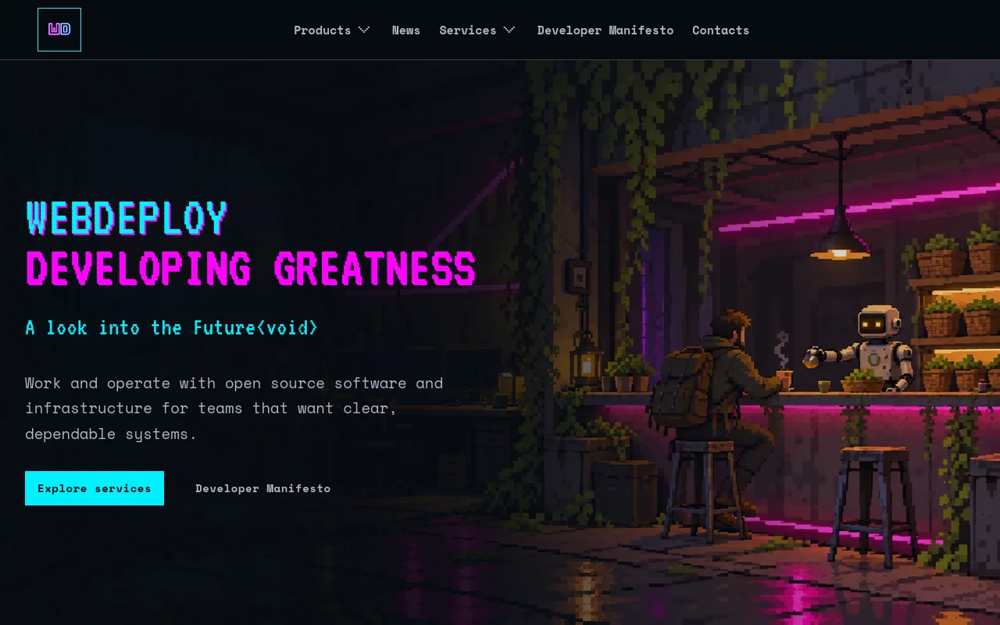

# webdeploy.it

Source code of [webdeploy.it](https://webdeploy.it), the website of WEBDEPLOY S.R.L.: a static
site about open source infrastructure, Linux workstations, backup and the inWD kiosk.



The site ships English HTML, CSS and native browser modules. A zero-dependency Node script builds
the pages and immutable assets. The newsletter uses a local ALTCHA widget and the contact page uses
local Leaflet with OpenStreetMap tiles.

## Repository and contributions

- The canonical repository is private, on WEBDEPLOY's own Forgejo instance. This GitHub repository,
  <https://github.com/WEBDEPLOY-Srl/webdeploy.it>, is a read-only mirror of it.
- **Contributions are accepted as issues only.** Pull requests are not accepted: changes made on the
  mirror would diverge from the canonical repository. Report bugs and suggest improvements through
  [GitHub issues](https://github.com/WEBDEPLOY-Srl/webdeploy.it/issues); see
  [CONTRIBUTING.md](./CONTRIBUTING.md).
- Security problems are not reported in public issues, see [Security](#security).

## Build and preview

Use Node.js 24 or newer. The repository's `.nvmrc` selects Node 26. From the project root:

```sh
cd src
node build.mjs
npm run dev
```

The build works offline without installing packages. The development server listens on
<http://127.0.0.1:5173> and rebuilds on source changes. Refresh the browser to see a new generation.
To watch without a server, use `node build.mjs --watch`. Use `npm run preview` to serve the last
successful build on port 4173. Clean URLs and the error document work in the preview.

The production image supplies the security policy, cache headers, MIME types, redirects and
compression. The build writes gzip sidecars for text assets. The pinned Alpine nginx image
serves these with `gzip_static` and includes no Brotli module. To verify the offline build and run the actual image on a Docker host with port
publishing enabled, use the repository root:

```sh
docker build --network=none -t webdeploy-it:local .
docker network create webdeploy-it-preview
docker run --rm --network webdeploy-it-preview -p 127.0.0.1:18080:80 webdeploy-it:local
```

Create the user-defined network once. On a Linux workstation without `docker0`, an alternative is
host networking with nginx bound explicitly to loopback:

```sh
preview_dir="$(mktemp -d)"
sed 's/listen 80;/listen 127.0.0.1:18080;/' nginx.conf > "$preview_dir/default.conf"
docker run --rm --network=host \
  --mount "type=bind,source=$preview_dir/default.conf,target=/etc/nginx/conf.d/default.conf,readonly" \
  webdeploy-it:local
```

## Structure and checks

| Location | Purpose |
|---|---|
| `src/pages/`, `src/partials/` | Semantic page templates and shared HTML |
| `src/data/`, `src/content/` | Routes and metadata, company facts, English text and the Italian archive |
| `src/assets/`, `src/static/`, `src/vendor/` | Authored CSS and browser JavaScript, public media, verified vendor files |
| `src/build.mjs`, `src/build-tools/` | Page generation, validation, compression, preview and the CI relay |
| `src/test/`, `src/e2e/`, `src/parity/` | Node tests, Firefox/Chromium production tests and migration screenshot comparisons |

From `src/` run `npm ci --include=dev` for development checks. `npm run lint` checks JavaScript
syntax, `npm run typecheck` runs strict TypeScript checking of JSDoc, and `npm run check` runs both.
Run `npm run test:unit`, `npm run build` and `npm audit --audit-level=high`. With the nginx image
running, `E2E_BASE_URL=http://127.0.0.1:18080 npm run test:e2e` runs the complete browser suite.
The [manual Lighthouse release gate](./CONTRIBUTING.md#lighthouse-production-gate) measures all
15 designs on mobile and desktop twice. Each cell requires a quiet workstation. Runtime errors and
measurements with a benchmark below 1000 are recorded under a bounded, score-blind retry policy.
Every non-404 visit must load the Matomo script exactly once and send at least one successful
tracking request without visitor input. On 2026-11-20 the owner accepted a mobile Performance 99
only when total blocking time is the sole failing audit and Matomo accounts for a majority of it.
The owner explicitly retained partial credit for Matomo's own synchronous `trackPageView` inside
the first-party adapter. The original profile measured 33.3 ms in that call and 1.9 ms in the other
calls. Four mobile measurements qualified. Desktop Performance and LCP have no such exception.
`--strict` requires four raw 100s. Woodpecker runs the independent functional checks on each push.

## Browsers and language

The browser baseline is Chrome/Edge 111, Firefox 114 and Safari 16.4. Styles use flat selectors,
cascade layers, custom properties and container queries. The site uses native document navigation
and browser history. Its primary content and navigation are available without JavaScript. Signup
requires JavaScript for its local spam check.

On `/newsletter`, the verified form sends a URL-encoded POST to the public Listmonk form.
A readable 2xx response shows the inbox reminder and clears the form. An HTTP error keeps the
address and choices. The endpoint must return `Access-Control-Allow-Origin: https://webdeploy.it`
and `Vary: Origin` on success and error responses. If the network or CORS makes the response
unreadable, Listmonk may already have accepted the request. The page keeps the fields and asks
the visitor to check their inbox before retrying in a few minutes. This avoids a second opt-in
email or another POST counting against the signup rate limit. Each submit uses one transport.
If fetch is unavailable before dispatch, the verified form posts by native navigation. With
JavaScript disabled the native form reaches Listmonk, which requires a valid proof to accept it.

The site serves English only. `src/content/en.mjs` and `src/content/it.mjs` retain matching keys,
array lengths and types. Enabling Italian in a future release requires generating `/it/` pages
with their own canonical URLs, paired hreflang and language navigation.

## Deployment

CI builds the container image on `main` and pushes it to a private registry; the production host pulls
that image and runs it behind a TLS-terminating reverse proxy. The image is a static nginx container, so
it can run anywhere and needs the reverse proxy only for TLS (and HSTS). `docker-compose.prod.yml` shows
how to run it by hand.

## Security

Report vulnerabilities privately to <security@webdeploy.it>, see [SECURITY.md](./SECURITY.md) and
<https://webdeploy.it/security>.

## Accessibility

The site targets WCAG 2.2 AA and is checked automatically on every push; see
[ACCESSIBILITY.md](./ACCESSIBILITY.md) for how it is tested, the known limits and how to report a problem.

## License

The source code is licensed under the [GNU Affero General Public License v3.0 only](./LICENSE.md)
(`AGPL-3.0-only`).

The WEBDEPLOY and inWD names and logos, photographs, customer imagery and the written content of the
website are © WEBDEPLOY S.R.L., all rights reserved. They are not covered by the AGPL. If you fork this
repository, replace them with your own.

Third-party material (fonts, icons, logos and libraries) keeps its own licence; see
[THIRD-PARTY-NOTICES.md](./THIRD-PARTY-NOTICES.md). Licensing is declared per file in
[REUSE.toml](./REUSE.toml) and can be checked with `reuse lint`.

Copies of this repository obtained under the earlier blanket AGPL-3.0 statement keep the grant they were
received under.

See also the [Code of Conduct](./CODE_OF_CONDUCT.md).
